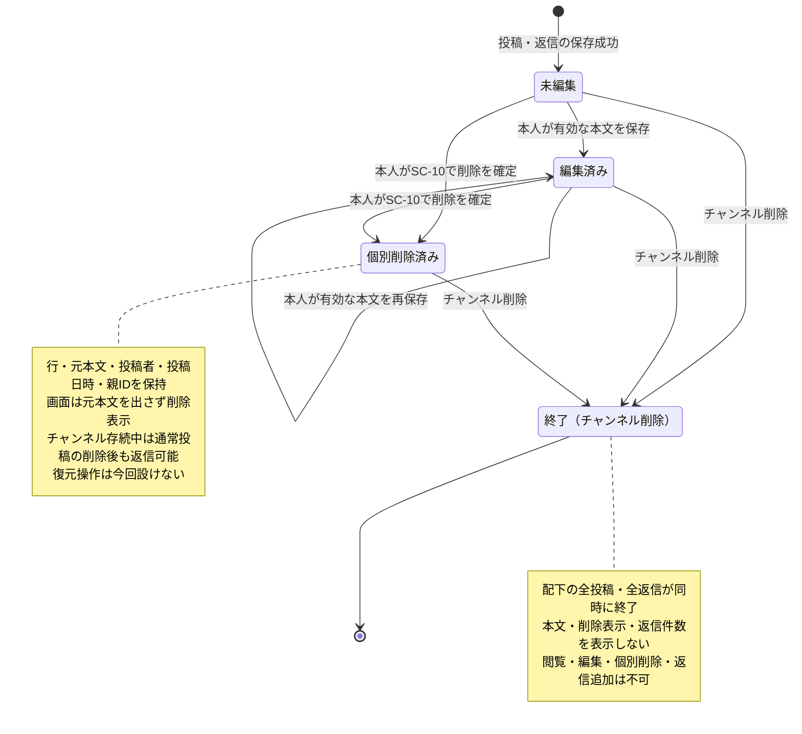
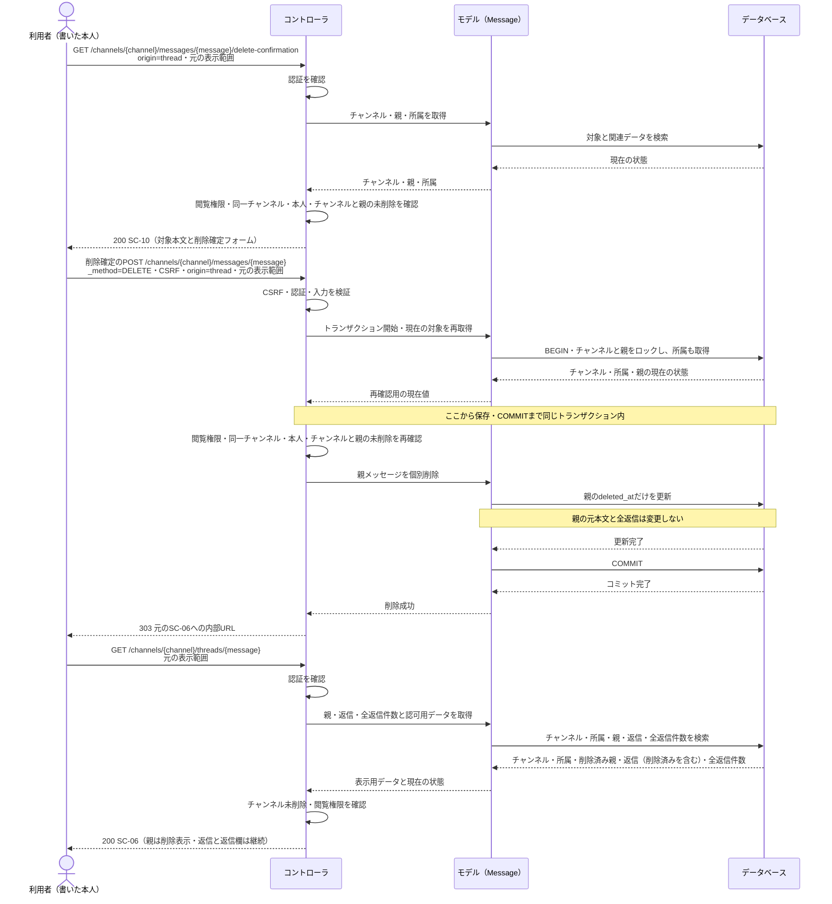

# 振る舞いの設計

[配置ルール](README.md)に従い、メッセージの状態遷移、代表処理のシーケンス、例外方針を定める。[機能一覧](features.md)・[画面設計](screens.md)・[データ設計](data.md)・[確認事項](questions.md)を先に読み、[仕様書](../spec.md)と[チャンネル画面](../../mockup/channel-show.html)・[スレッド](../../mockup/thread.html)・[デザイン指定書](../../mockup/design-guide.md)を照合した。作成日：2026-10-27。

状態と保持・表示条件は既存資料の要件に基づく。HTTPステータス、再確認の時点、トランザクション、競合時の扱いは、その要件を満たすための今回の技術的設計として区別する。URL・入力・公開APIのJSON形式は[権限・ルーティング・API設計](permissions-api.md)を参照する。

## メッセージの状態遷移

通常投稿と返信に同じ状態を適用する。チャンネルが存続する間は未編集・編集済み・個別削除済みを区別し、チャンネル削除時はその区別にかかわらず配下の全投稿・全返信をまとめて終了させる（Q-26の追加指定）。図の「終了」は利用上の終端であり、親チャンネルの削除日時から判定する。返信の有無、親メッセージの個別削除、本文の編集中・競合確認中、SC-10での確認中は、追加の永続状態を作らない（F-13〜F-16、Q-05・Q-06・Q-17・Q-22・Q-30）。

| 状態 | 判定条件・保存値 | 表示・操作 |
|:--|:--|:--|
| 終了（チャンネル削除） | `channels.deleted_at IS NOT NULL`。メッセージ自身の編集・削除の値を問わず最優先で判定 | 配下の会話全体が終了。本文・削除表示・返信件数・返信欄を含めて表示せず、すべての閲覧・変更を認めない |
| 未編集 | チャンネルが未削除、`messages.edited_at IS NULL`、`messages.deleted_at IS NULL` | 本文を表示。本人が編集・削除できる |
| 編集済み | チャンネルが未削除、`messages.edited_at IS NOT NULL`、`messages.deleted_at IS NULL` | 本文と「編集済み」を表示。本人が再編集・削除でき、編集期限はない（A-05） |
| 個別削除済み | チャンネルが未削除、`messages.deleted_at IS NOT NULL`。`edited_at`の有無は問わない | 元本文に代えて「このメッセージは削除されました」を表示。投稿者・投稿日時・位置を残す。編集・再削除の操作は出さない |

- 各変更には、その時点でチャンネルが未削除で、本人に閲覧・投稿権限があることを要求する。チャンネル作成者にも、他人の投稿・返信を編集・個別削除する権限はない（仕様 §3-2〜§3-4）。
- 本文編集の保存成功では`body`と`edited_at`を更新し、競合検知用の`version`を1増やす。競合確認で保存を止めた場合は変更しない。個別削除では`deleted_at`だけを更新し、元本文を削除文言で上書きしない。削除で「編集済み」へ遷移させない（data.md、Q-17・Q-25・Q-30）。
- SC-10を開いた時点では変更しない。「やめる」・入力エラー・認可エラー・保存失敗では、その操作自体による保存状態の変更を行わない。別操作でチャンネルが削除されていれば、終了判定を優先する。確認と確定は別のリクエストとして扱う（Q-18・Q-22・Q-23・Q-26）。
- 個別の親削除は、返信の`deleted_at`や`parent_message_id`を変更しない。チャンネルが存続する間は、個別削除済みの親にも返信を追加できる。返信件数には個別削除済みの返信も含め、過去分を含む全件を数える（A-06、Q-06・Q-15・Q-24）。
- 未削除チャンネルの会話・スレッドには個別削除済みの行も含めるが、元本文をHTML・編集欄・削除確認欄へ出さない。検索・公開APIは個別削除済みメッセージを件数計算・ページ分割より前に除外し、個別削除済み親の未削除返信は取得できる（Q-09・Q-12・Q-13・Q-24）。
- チャンネル削除では、通常投稿・返信の未編集・編集済み・個別削除済みすべてを「終了」へ遷移させる。削除表示や既存返信だけを独立して存続させず、会話全体を画面・検索・公開APIから除外する。保存上は`channels.deleted_at`を更新し、行・本文・所属と個別の編集日時・削除日時を保持する。子の保存値が残っていても利用上の状態は終了となり、復元操作は設けない（Q-26）。

## 代表シーケンス：返信付きの親を投稿者本人が削除

SC-06で開いているスレッドの親を、投稿者本人が削除する成功例を示す。対象チャンネルは未削除で閲覧可能、親には返信が付いており、親自身は未削除とする。図はこの1本だけとし、異常時の応答は次節にまとめる。認証・CSRFのミドルウェア処理はコントローラ側にまとめ、モデル（Message）は関連するチャンネル・所属の取得も表す。

削除確認のGETは更新を行わない。HTMLフォームはPOSTと`_method=DELETE`を使い、JavaScriptを使わず通常の画面遷移で実行する（Q-18）。確定時には、SC-10を開いた時点の認可結果を使い回さず、現在のチャンネル・所属・投稿者・削除状態を再確認する。

`origin=channel|thread`と必要な会話・返信の表示範囲をSC-10へ引き継ぎ、確定フォームと「やめる」にも保持する。サーバーは対象IDとの整合性を検証し、SC-05またはSC-06への内部URLを生成する。外部の`return_url`は受け付けない。元がSC-05ならSC-05へ、元がSC-06ならSC-06へ、確定・中止のどちらでも戻る（Q-23）。削除後も同じ親IDでスレッドを開ける。

削除と同時に別の返信が保存されても、親の個別削除によってその返信を消さず、次の表示時点の全返信件数に含める。確認後にチャンネル削除・メンバー解除・別リクエストによる個別削除が行われていた場合は、下表の404または409とし、元本文を再表示しない。

## 例外方針

次のHTTP応答と競合処理は今回の技術的設計である。画面の入力条件・文言・エラーの見せ方は[screens.md](screens.md)に従う。公開APIはHTMLへリダイレクトせず、[APIのエラー形式](permissions-api.md)に従うJSONを返す。

| 条件 | 画面の応答・扱い | 公開APIの扱い |
|:--|:--|:--|
| 未認証・ログインの有効期限切れ | 保護された画面へのアクセスは`302`でログイン画面（SC-01、`/login`）へ送り直す。登録・変更・削除は実行しない。ログイン成功後はQ-08どおりチャンネル一覧（SC-03）へ | 認証不要。ログインの有無・有効期限をエラーにしない |
| CSRFトークン不正・有効期限切れ | 送信そのものを拒否し、登録・変更・削除は実行しない。通常のフォーム送信は`302`で`/login`へ自動転送し、入力値を保持・自動再送しない。JSON要求は`419`を返す（2026-10-30ユーザー決定） | 読み取り専用GETのためCSRF検証は適用しない |
| 対象なし、削除済みチャンネル、未参加プライベート | `404`。「対象が見つかりません」とし、存在・名前・公開種別を明かさない。チャンネル削除による終了は、個別削除の409や編集競合より先に判定し、本文・削除表示・返信を返さない | プライベート・削除済み・不存在を同じ`404 NOT_FOUND`・同じ本文にする |
| URLのチャンネルとメッセージが不一致、スレッド対象が返信 | `404`。別チャンネルの本文や親子情報を出さない | メッセージ個別・スレッドの公開APIは提供しない |
| 閲覧できる対象で、本人以外が個別編集・削除、作成者以外がチャンネル管理 | `403`。「この操作はできません」。操作ボタンの非表示だけに頼らず、サーバーで拒否する | 書き込みのAPIは提供しない |
| 入力不備、認証情報不一致、チャンネル削除確認名の不一致 | 変更フォームは更新せず`303`で同じフォームのGETへ戻す。通常投稿・返信は開いていたスレッドと表示範囲を維持し、送信した欄だけに本文のOld Inputとエラーを表示する（Q-34）。本文編集では入力本文と元の`expected_version`をセットで保持する。パスワード・確認用パスワードは引き継がない。GETの不正な検索・表示パラメータは`422`で同画面に案内する | 不正な`page`・`until_id`などは`422 VALIDATION_ERROR` |
| メール・未削除チャンネル名の同時登録による一意制約違反 | 保存前の重複チェックをすり抜けても、該当フォームの入力エラーへ変換して`303`。チャンネル名は事前検証と同じ「使用できない名前です」とし、重複という理由・既存チャンネルの情報・公開種別は説明しない（Q-28）。メールの文言はscreens.mdに従う | 登録・変更APIは提供しない |
| 削除済みメッセージの編集開始・削除確認・編集確定・再削除 | `409`。「このメッセージは削除されています」。元本文・送信した旧本文を編集欄や確認欄に再表示しない | 削除済みメッセージを取得対象から除外。親が削除済みでも未削除返信は返す |
| 未削除メッセージの編集中に別の編集が成功した | 保存せず`409`で同じSC-05／SC-06の編集位置に競合を案内。現在保存されている本文と自分の入力を表示し、確認・再編集後に保存できるようにする（Q-30） | 変更APIは提供しない。読み取り結果は現在の本文 |
| 未提供のHTTPメソッド | `405`。更新しない | `405 METHOD_NOT_ALLOWED`。許可メソッドはGET・HEAD |
| 予期しない障害・DB障害 | 保存トランザクション中ならロールバックして`500`。「処理に失敗したため時間をおいて再度お試しください」。成功が確認できない操作を保存成功と表示しない | `500 INTERNAL_ERROR`。内部エラーの詳細をJSONに含めない |

変更リクエストはCSRF検証を通過してから認証を判定する。CSRF不一致での転送先は固定のGET /loginとし、送信元の操作は再実行しない。CSRF不一致だけで既存の認証状態は変更しない。ログイン済みのGET /loginの扱いは[ルーティング一覧](permissions-api.md#ルーティング一覧通常画面)を参照する。

認証後は、対象チャンネルを見せてよいかを判定してから本人・作成者の操作権限を判定する。したがって未参加プライベートには403で存在を知らせず404とする。入力エラー画面へ戻す際にも閲覧権限と削除状態を確認し、保持している元本文を再出力しない。

0件の検索・空のチャンネル・返信0件は正常な表示であり、404や入力エラーにしない。検索の有効な要求ページが現在の最終ページを超えた場合は、検索語・並び順・初回ID上限を維持し、最後のページへ302リダイレクトする。全体0件では最終ページを1として1ページ目で0件案内を表示する（Q-36）。公開APIの一覧0件・範囲外ページは、従来どおり空配列を含む`200`とし、検索のリダイレクト方針を適用しない。

### 更新の整合性と同時操作

- チャンネル作成と作成者の所属作成、チャンネル削除、メンバー変更、メッセージ投稿・編集・削除は、必要な確認と保存を同一トランザクションで行う。保存失敗時に一部だけ成功した状態を残さない。
- メッセージ編集・削除では対象行をロックし、`deleted_at IS NULL`を再確認して保存する。編集では`expected_version`との一致も確認し、`body`・`edited_at`・`version`を同時に更新する。削除後に遅れて届いた編集で本文を更新したり、削除状態を戻したりしない。編集が先に確定した場合、その時点の本文を保持して削除する。
- 閲覧・投稿・管理の可否は送信時の現在の所属とチャンネル状態で判断する。チャンネル削除やメンバー解除との同時処理でも、同一チャンネルの変更を直列化して再確認し、権限を失った状態で更新を確定しない。
- 未削除メッセージに対する複数の編集は、Q-30に従い後に成功した編集を採用する。古い版のフォームでは先に競合を通知し、現在の本文を確認した上で保存を完了できるようにする。通知の表示時点では本文を上書きしない。
- 想定内の入力・認可・状態エラーと、予期しない障害を区別する。障害ログには操作・対象ID・例外の識別に必要な情報を記録し、パスワード・確認用パスワード・メッセージ本文を記録しない。エラー応答にもSQLやスタックトレースを出さない。
- コミット後の応答障害では保存をロールバックできない。投稿を自動再送せず、画面を開き直して結果を確認する案内を出す。通常投稿・返信の二重送信を識別する仕組みは今回設けず、削除の再確定は409、メンバー追加・解除の再送はルーティング設計の変更なしの扱いに従う。

### 本文編集の競合確認（Q-30）

1. 編集開始時に、現在の本文と同じ読み取り時点の`version`を取得する。フォームは本文と`expected_version`を保持する。本文の入力エラーで303に戻す場合も、この組み合わせを維持する。
2. 保存時は現在の閲覧権限・本人・未削除を先に確認し、行ロック内で版を比較する。版が違う場合は更新せず、元の表示範囲・編集位置を残した409応答で「別の画面で編集されています 内容を確認して保存してください」と案内する。
3. 「現在保存されている本文」を読み取り専用で示し、「自分の入力」は再編集できる欄に残す。「確認した内容で保存」と「やめる」を表示する。再送用の版は、表示した現在本文と同時点の値へ更新する。
4. 確認後の保存でも再度版を比較し、その間に変更されていれば同じ確認を繰り返す。一致すれば保存・版加算を行い、303で元の画面へ戻る。「やめる」も元の画面・表示範囲へ戻る。

同じ版のフォームが同時送信された場合は、一方が成功し、他方は競合確認になる。確認できるのは現在保存されている直近の本文と自分の入力であり、編集履歴一覧・過去版の復元は設けない。削除済み・権限喪失を検知した場合は競合確認より先に拒否し、保存済み本文や送信した旧本文を再表示しない。JavaScript・新しい画面番号・追加のシーケンス図は必要としない。

## 構成

Laravelの標準的なMVC構成に従う。

### チャンネルの実装（Issue #2）

- Controllerは画面と303遷移、FormRequestは入力検証、Policyは閲覧と作成者の管理権限、保存用Actionはトランザクションを担当する。対象チャンネルは未削除の現在値を取得し、閲覧不可を404、閲覧可能だが作成者でなければ403の順に拒否する。FormRequestの入力検証前にも認可する。
- 一覧・サイドバーは未削除かつ公開または本人の所属ありに限定し、`created_at`・同日時は`id`の昇順で取得する。
- 作成はログイン社員を作成者に設定して、所属の挿入まで同一トランザクションで行う。編集・削除はチャンネル行の`lockForUpdate()`後、未削除・閲覧・作成者を再確認する。削除確認名もロック後の現在名と厳密一致で再検証する。
- 保存は検証済みの名前・説明と、作成時のみ公開範囲を使用する。作成者ID・削除日時・生成列などの入力は採用しない。名前の一意制約違反だけを「使用できない名前です」に変換し、その他の保存障害は既存の500応答・ログ方針に従う。
- 入力エラーの303先は作成・編集・削除確認の固定の内部URLとし、操作と対象IDに対応付けた文字列と空入力のNULLを保持し、不正な配列などは保持しない。空入力を示すキーは残し、編集前の保存値で補わない。別のフォームや対象の入力を流用しない。
- 後続のメンバー変更・会話更新も同じチャンネル行を最初にロックして直列化する。今回の実装だけでは、それらとの結合動作や検索・公開APIからの除外の検証完了とはしない。

## Fortifyによる認証の実装（Issue #1）

認証の応答・遷移は[ルーティング一覧](permissions-api.md#ルーティング一覧通常画面)、入力と文言は[入力チェック](screens.md#入力チェックとエラーメッセージ)、例外処理は[例外方針](#例外方針)を参照する。

実装上の拡張箇所は次に限定する。

- 登録は`CreateNewUser` Action、ログインの検証はFortifyのLoginRequestを継承したFormRequest、共通の前処理は`NormalizeAuthInput`で行う。`lowercase_usernames`はfalseとし、比較規則は[data.mdのusers定義](data.md#テーブル定義書)を参照する。
- 認証コントローラー・パイプラインはFortify標準を使う。応答契約への対応はLoginResponse・RegisterResponse・LogoutResponseと例外Handlerに配置する。
- 登録Actionで一意制約違反をValidationExceptionへ変換する。障害ログの出力箇所は例外Handlerに集約する。
- 認証フォームのOld Inputはname・emailのうち文字列の値だけを保持し、配列などの不正な型は再表示しない。エラー表示は[入力チェック](screens.md#入力チェックとエラーメッセージ)を参照する。
- 既存の認証必須JSON要求（例：GET /api/user）の未認証応答は、Laravel標準の401 JSONを維持する。画面の遷移は[例外方針](#例外方針)を参照する。

Q-39（2026-10-29ユーザー決定）：正規化後のメールアドレスとIPの組み合わせをハッシュ化したキーで、ログインのPOSTを1分間に5回までとする。メールの比較規則は上記のusers定義を参照する。超過時は429とRetry-Afterを返し、「ログインの試行回数が多すぎます 時間をおいて再度お試しください」と表示する。
