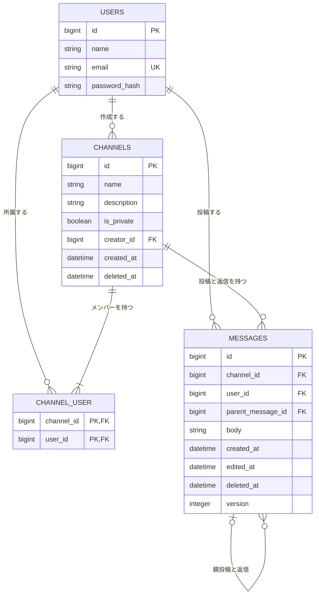

# データ設計

[機能一覧](features.md)、[確認事項](questions.md)、[画面設計](screens.md)を先に読み、[仕様書](../spec.md)・[モックアップ](../../mockup/index.html)と照合した。配置は[README](README.md)に従う。作成日：2026-10-27。

業務データは `users`・`channels`・`channel_user`・`messages` の4表にまとめる。通常投稿と返信は同じ表で親IDにより区別する。文字数・公開範囲・作成者の権限は元資料、削除データの保持と取得条件はQ-06・Q-17・Q-24〜Q-27の決定を根拠とする。表名・列名・集計方法は、それらを満たすための設計として定める。

## ER図

`PK`は主キー、`FK`は外部キー、`UK`は一意性を表す。`channel_user`の主キーは2列の組み合わせ。`channels.name`の一意性は**未削除の行だけ**を対象にするため、図では列単独の`UK`にしていない。

通常投稿の `parent_message_id` はNULLで、返信だけが親を持つ。返信先は同じチャンネルの通常投稿1件に限る。自己参照の外部キーだけでは「同じチャンネル」「親は通常投稿」を保証できないため、登録時にも検証する（仕様 §3-5、Q-05）。

## テーブル定義書

型は原則として論理型で示し、ユーザーがQ-37で指定したメールは物理型`VARCHAR(255)`を記載する。IDは一意な整数、日時は時点を保存する列とし、画面表示はJSTに統一する（Q-16）。文字数は仕様と追加のユーザー決定に従う。DB製品ごとの制約の書式など、資料だけでは埋められない部分は末尾に明記する。

### users：社員アカウント

根拠：仕様 §3-1・§5-1、[登録画面](../../mockup/register.html)、[ログイン画面](../../mockup/login.html)、[メンバー管理](../../mockup/members.html)、F-01・F-02・F-09、Q-02・Q-07。

| 列 | 型・長さ | NULL | キー・初期値 | 用途・制約 |
|:--|:--|:--|:--|:--|
| id | 整数ID | 不可 | PK、自動採番 | 作成者・メンバー・投稿者を識別する。表示名では関連付けない |
| name | 文字列・30文字まで | 不可 | — | 表示名。同姓同名は許容し、メンバー候補ではメールアドレスも表示する |
| email | VARCHAR(255) | 不可 | 正規化後の値で一意制約 | 前後空白・改行を除去し、ドメインの英字を小文字に揃えて保存する。登録・ログイン・重複確認で同じ処理を使う。`@`より前の大小・全角半角・Unicodeの表記差は変換しない。登録・ログインとも正規化後の形式と255文字以内を確認し、切り捨てない（Q-32・Q-37） |
| password_hash | Argon2idのハッシュ文字列 | 不可 | — | 登録パスワード全体を切り捨てずにハッシュ化し、ログイン時に照合する。登録入力は8〜128文字で、空白除去・大小変換・Unicode正規化はしない。保存するハッシュの長さとは分ける（Q-38） |

確認用パスワードは入力されたパスワードとの変換なしの一致確認にだけ使用する入力で、保存列を設けない。平文は保存せず、Argon2idを使う（Q-38）。アカウント名・パスワードの変更画面は今回不要とのA-13を維持する。認証状態の保存方法は、仕様 §3-1で委任されている認証の実装設計で定める。

メールの正規化は有効なメール構文を前提に行い、空白除去後の形式も検証する。全角の`＠`を区切りとして受け入れるなど、文字変換で受理形式を広げる決定ではない。DBの一意制約とログイン照合も、正規化後の文字列に同じ比較規則を適用する（Q-02・Q-32・Q-37）。検索用のNFKC・英字小文字化（Q-35）は、保存・一意性・ログイン照合へ流用しない。

### channels：チャンネル

根拠：仕様 §3-2・§5-1、[作成](../../mockup/channel-new.html)・[編集](../../mockup/channel-edit.html)・[一覧](../../mockup/channels.html)、F-04・F-05・F-07・F-08、Q-04・Q-14・Q-26・Q-27。

| 列 | 型・長さ | NULL | キー・初期値 | 用途・制約 |
|:--|:--|:--|:--|:--|
| id | 整数ID | 不可 | PK、自動採番 | 名前を再利用しても新しいIDを発行する |
| name | 文字列・50文字まで | 不可 | 未削除の行に限り完全一致で一意 | 公開・プライベートを通して同名不可。前後空白・英字大小・全角半角・Unicodeの表記差は区別し、入力した値をそのまま保存する。削除済みの行は一意性の対象から外す（Q-27・Q-32） |
| description | 文字列・200文字まで | 可 | 未入力はNULL | 任意の説明 |
| is_private | 真偽値 | 不可 | 作成時に指定 | false＝公開、true＝プライベート。作成後は変更不可 |
| creator_id | 整数ID | 不可 | FK → users.id | チャンネル作成者。今回は交代させない（A-04） |
| created_at | 日時 | 不可 | 作成日時 | 一覧・サイドバー・公開チャンネル一覧APIの作成順に使用 |
| deleted_at | 日時 | 可 | 作成時はNULL | NULL＝未削除、日時あり＝削除済み。削除時に更新する |

チャンネル削除時は、配下の全メッセージ・全返信を個々の編集・個別削除の状態にかかわらず利用上の「終了」とする。チャンネル・所属情報・会話の行と本文は保持し、名前・説明・削除表示・返信件数を含めて画面・検索・公開APIから除外する。配下の`messages.deleted_at`は一括更新せず、編集日時・個別削除日時などの保存値を残すが、終了判定は`channels.deleted_at`を最優先する（Q-26の追加指定）。

未削除の同名作成・編集は、原文の完全一致によるバリデーションと、同時の操作でも重複させないDBの一意制約を併用して保証する。どちらで検出しても「使用できない名前です」に統一する。単純な名前全体の一意制約では、削除後の再利用を実現できない。具体的な制約の実装はDB製品に合わせる（Q-33、末尾参照）。

チャンネル名は、空判定のための前後空白除去と保存値を分ける。空白だけの名前は従来どおり不可だが、`開発`と`開発 `は別名となる。英字大小・Unicodeの表記差・末尾空白まで区別できる比較方法を、重複検証・DB制約・削除確認名の一致判定で揃える。DBの既定の比較に任せず、末尾空白を含めすべての差を区別できることを確認する（Q-21・Q-32）。

### channel_user：チャンネルへの所属

根拠：仕様 §3-2・§3-3、[メンバー管理](../../mockup/members.html)、F-05・F-06・F-09・F-10、A-04、Q-26。

| 列 | 型・長さ | NULL | キー・初期値 | 用途・制約 |
|:--|:--|:--|:--|:--|
| channel_id | 整数ID | 不可 | 複合PK、FK → channels.id | 所属先チャンネル |
| user_id | 整数ID | 不可 | 複合PK、FK → users.id | 所属する社員。同じチャンネルへの二重登録を禁止 |

- チャンネル作成と作成者の所属行の作成は、一つのトランザクションで行う。公開・プライベートとも作成者を自動でメンバーにする。
- プライベートの閲覧・投稿では所属行を確認する。公開はログインした社員全員が利用でき、全社員分の所属行を作る必要はない。
- プライベートの追加・解除は作成者だけが行い、作成者本人の所属行は削除できない。メンバー解除は所属行だけを削除し、その人の過去の投稿・返信は消さない。
- チャンネル削除時は所属行も保持する（Q-26）。削除済みチャンネルへの所属は、閲覧権限を与える根拠として使わない。

### messages：通常投稿と返信

根拠：仕様 §3-4・§3-5・§5-1、[チャンネル](../../mockup/channel-show.html)・[スレッド](../../mockup/thread.html)、[ガイド §4](../../mockup/design-guide.md#4-状態の決まり)、F-11〜F-17・F-19、Q-05・Q-06・Q-12・Q-13・Q-17・Q-24・Q-25。

| 列 | 型・長さ | NULL | キー・初期値 | 用途・制約 |
|:--|:--|:--|:--|:--|
| id | 整数ID | 不可 | PK、自動採番 | 投稿・返信の識別子。個別削除後も変えない |
| channel_id | 整数ID | 不可 | FK → channels.id | 所属チャンネル。返信も親と同じチャンネルIDを持つ |
| user_id | 整数ID | 不可 | FK → users.id | 投稿者。自分の投稿の編集・削除判定にも使用 |
| parent_message_id | 整数ID | 可 | FK → messages.id、通常投稿はNULL | 返信は同一チャンネルの通常投稿を参照する。返信への返信・自分自身の参照は不可 |
| body | 複数行の文字列・1,000文字まで | 不可 | — | 通常投稿・返信の本文。個別削除時も元本文をそのまま保持し、削除文言で上書きしない |
| version | 正の整数 | 不可 | 初期値1 | 本文編集の競合検知用。本文編集の保存成功ごとに1増やす。画面へ本文と同じ時点の値を渡し、送信された`expected_version`と照合する（Q-30を満たす技術設計） |
| created_at | 日時 | 不可 | 投稿日時 | 会話の順序、検索・APIの並べ替え、表示日時に使用 |
| edited_at | 日時 | 可 | 未編集はNULL | 本文を編集した日時。「編集済み」の判定に使用し、削除だけでは変更しない |
| deleted_at | 日時 | 可 | 未削除はNULL | 個別削除した日時。削除時にこの列を更新し、行・本文・投稿者・投稿日時・親IDを残す |

返信先は削除済みの通常投稿でもよい。個別の親削除では返信を連鎖削除しない。表示順のためにIDを付け直したり、親IDをNULLへ変えたりしない（A-06、Q-13・Q-17）。

「編集済み」は `edited_at` の有無で判定する。汎用的な更新日時の変化で判定すると、削除しただけで編集済みになるため、本文編集の事実を独立して持つ。過去の編集本文を保存する履歴表は設けない。

`version`は履歴件数ではない。初期データの未編集・編集済み・削除済みはいずれも1から開始し、その後の本文編集成功時に`body`・`edited_at`と一緒に更新する。個別削除は従来どおり`deleted_at`だけを更新する。競合の確認画面には現在保存されている本文と入力中の本文を出すが、過去のすべての編集本文を保存・復元する機能は追加しない（Q-30）。

## 保存しない表示項目・集計

| 項目 | 取得・表示方法 | 根拠 |
|:--|:--|:--|
| 「このメッセージは削除されました」 | `deleted_at` がある行を画面側で削除表示にする。`body`へは入れない | Q-17・Q-25、ガイド §4 |
| 返信件数 | 対象の通常投稿IDを `parent_message_id` に持つ行を集計。削除済み返信も含め、取得済み10件の件数とは分ける | Q-06・Q-15、SC-05・SC-06 |
| メンバー数・作成者の印 | 所属行の件数と、`channels.creator_id` との一致から求める | members.html、F-09・F-10 |
| チャンネル削除確認の通常投稿数・返信数 | 対象チャンネルの行を親IDのNULL／非NULLで分けて集計。個別削除済みの行も対象 | channel-edit.html、Q-06・Q-26 |
| アバター・公開／プライベートの印 | 投稿者と公開種別からモック・ガイドに沿って表示。画像の保存列は作らない | 各モック、ガイド §1・§5 |

## 削除状態と取得条件

チャンネルの削除日時がある場合は、配下の通常投稿・返信をすべて終了として扱い、メッセージ自身の`edited_at`・`deleted_at`による区分より優先する。これは保存値を消去する処理とは分ける。以下の会話表示・返信追加は、チャンネルが未削除であることを前提とする（Q-26）。

`SoftDeletes`などによる既定の除外だけで、表示・検索・集計を共用しない。次の条件を取得側で明示し、本文を画面用・API用に取り出す際にも適用する（Q-24）。

| 用途 | チャンネルの条件 | メッセージの条件・出力 |
|:--|:--|:--|
| チャンネル一覧・サイドバー | `channels.deleted_at IS NULL`、公開または本人が参加するプライベート | メッセージは取得しない。未参加プライベートの存在も出さない |
| 会話・スレッドの親と返信 | 未削除で、本人に閲覧権限がある | 個別削除済みも含めて取得。削除済みは元本文を出さず、投稿者・日時・削除表示を出す |
| 返信件数 | 未削除で、画面では閲覧権限、公開APIでは公開を確認 | 対象親の返信を削除済みも含めて集計する |
| 通常投稿・返信の追加先 | 未削除で、本人に投稿権限がある | 返信先の親は削除済みでも可。親が同一チャンネルの通常投稿であることを確認 |
| 本文編集・個別削除の対象取得 | 未削除で、本人に権限がある | 本人の対象を確認し、削除済みの元本文を編集用・確認用の画面へ再出力しない |
| 検索 | 未削除で、本人に閲覧権限がある | `messages.deleted_at IS NULL`、通常投稿・返信の本文を部分一致・複数語ANDで検索 |
| 公開チャンネル一覧API | 未削除かつ公開 | プライベートチャンネル・削除済みチャンネルの情報は返さない |
| 公開メッセージ一覧API | 指定先が未削除かつ公開 | `messages.deleted_at IS NULL`。未削除返信は親が個別削除済みでも返し、親IDを付ける。削除済みの親のレコード・本文は返さない |

検索と公開メッセージ一覧APIは、チャンネルの公開・閲覧条件と削除状態を**件数計算・ページ分割より前**に適用する。検索の一致件数へ削除済みを含めたり、APIの取得後に削除済みを間引いたりしない。返信の検索・API取得で「親も未削除であること」を条件にしない（Q-09・Q-12・Q-13・Q-15）。

検索と公開APIのページ移動には、初回にその利用者・APIへ返せる対象から求めた最大IDを上限として引き継ぐ（Q-31）。現在の閲覧・削除・検索条件と`id <= until_id`を適用してから、件数計算・ページ分割する。公開メッセージAPIは対象の公開チャンネルの通常投稿・返信に共通の上限を使い、両枠を別々に5件ずつ取得する。全チャンネル共通の最大IDを公開しない。上限を超える新規IDの混入を防ぐ方式であり、削除・本文編集・所属変更によるずれまで防ぐ時点固定ではない。

本文・メンバー候補の検索は、検索語と対象テキストの比較用の値だけをNFKC正規化・英字小文字化する。本文は複数語AND、メンバー候補は入力語全体の部分一致とし、保存済みの本文・表示名・メールは変更しない。強調は元本文の対応範囲に付ける。検索用の永続列・履歴表は追加しない（Q-35、詳細はpermissions-api.md）。

画面では通常投稿・返信とも最初は最新10件を古い順、検索は10件ずつで初期は新しい順、公開メッセージ一覧APIは通常投稿と返信をそれぞれ新しい順で最大5件ずつとする。APIの不足分は補充しない。個別メッセージの削除表示はチャンネル存続中だけの扱いであり、チャンネル削除では個別状態を問わず全件終了となるため、削除表示も返信も外へ出さない。

## CRUD表

行は[機能一覧](features.md)のF-01〜F-23、列は上記4表。`C`＝行の作成、`R`＝参照・検索・集計、`U`＝既存行の更新、`D`＝行の物理削除。論理削除は `deleted_at` の更新なので `U` とする。`—` はその機能に独立した永続操作がないことを表し、未設計の空欄ではない。

機能固有の業務データ操作を示し、共通ヘッダーの再描画・外部キーによる内部確認・成功後に別機能の一覧を表示する処理は重ねて数えない。

| 機能 | users | channels | channel_user | messages |
|:--|:--|:--|:--|:--|
| F-01 アカウント登録 | R/C | — | — | — |
| F-02 ログイン | R | — | — | — |
| F-03 ログアウト | — | — | — | — |
| F-04 チャンネル一覧・切り替え | R | R | R | — |
| F-05 チャンネル作成 | — | R/C | C | — |
| F-06 チャンネルの閲覧・投稿制御 | — | R | R | — |
| F-07 チャンネル編集 | — | R/U | — | — |
| F-08 チャンネル削除 | — | R/U | — | R |
| F-09 メンバー一覧・追加対象の検索 | R | R | R | — |
| F-10 メンバー追加・解除 | R | R | R/C/D | — |
| F-11 メッセージ閲覧 | R | R | R | R |
| F-12 メッセージ投稿 | — | R | R | C |
| F-13 自分のメッセージ編集 | — | R | R | R/U |
| F-14 自分のメッセージ削除 | — | R | R | R/U |
| F-15 スレッド閲覧・返信件数 | R | R | R | R |
| F-16 スレッド返信 | — | R | R | R/C |
| F-17 メッセージ検索 | R | R | R | R |
| F-18 公開API：チャンネル一覧 | — | R | — | — |
| F-19 公開API：メッセージ一覧 | R | R | — | R |
| F-20 入力制約とエラー表示 | — | — | — | — |
| F-21 共通の画面・状態表現 | — | — | — | — |
| F-22 初期アカウント・チャンネル | C | C | C | — |
| F-23 初期の会話データ | R | R | — | C |

全4表が「—」の機能は、次の理由で独立したCRUDを割り当てていない。

| 機能 | 全列が「—」になる理由 |
|:--|:--|
| F-03 ログアウト | 認証状態を無効化する処理で、4業務表のアカウント・チャンネル・所属・メッセージには独立した参照・変更を行わない。認証状態の保存先とその操作は、認証実装で定める |
| F-20 入力制約とエラー表示 | 必須・文字数などの入力チェックとエラー表示に、独立した保存データはない。メールやチャンネル名の重複確認に必要なRは、F-01・F-05・F-07に計上する |
| F-21 共通の画面・状態表現 | 配色・余白・文字・日時書式・状態の見せ方をそろえる要件で、独立したCRUDは発生しない。表示元データの参照は、一覧・会話・検索など各機能のRに計上する |

- F-01のRはメール重複、F-05・F-07のチャンネルRは未削除の同名確認も含む。
- F-08はチャンネルの削除日時だけを更新し、その値で全投稿・全返信を終了と判定する。所属・メッセージの保存行は保持し、messagesのRは削除確認の件数表示に使う。業務上の終了と保存列の更新先を分け、配下の取得を止める条件は上表に従う（Q-26）。
- F-10のDは作成者以外のメンバー解除。アカウント・過去の投稿を削除する操作ではない。
- F-14は本文を残したまま削除日時を更新する。F-13だけが本文と編集日時を更新する。
- F-22・F-23は仕様 §5-4の初期データ作成。固定の3人・4チャンネルと所属を守り、編集済み・削除済みは対応する日時を持つ状態で作成する。

## 埋めなかった箇所と、対象外の永続データ

| 箇所 | 資料から確定できること | まだ埋めていないこと・扱い |
|:--|:--|:--|
| users.email | Q-37で`VARCHAR(255)`と入力255文字以内を決定。Q-32の正規化後の値に一意制約を設ける | 大小・末尾空白等の比較規則を保つ具体的なDB制約の書式は使用DBに合わせる。型・入力上限は未指定ではない |
| users.password_hash | Q-38でArgon2id、登録入力8〜128文字を決定 | ハッシュ保存長と生成設定の具体値は認証実装で定める。入力長と保存形式を混同しない |
| 各ID・日時列 | 関連先、作成・編集・削除という意味、画面のJST表示 | DB製品固有の型・保存タイムゾーン・自動採番の書式は未指定。物理設計で統一する |
| channels.nameの一意制約 | 未削除の行だけで完全一致の一意、削除済みの名前は再利用可。表記差を区別するQ-32を適用 | DB製品に合わせた条件付きの一意性の実装は未指定。`(name, deleted_at)`を並べるだけで保証できると仮定しない。末尾空白や大小を同一視しない比較を保証する |
| F-02・F-03の認証状態 | ログインで開始し、ログアウトで無効化する | セッションの保存先・基盤テーブルは資料に未指定。4業務表のCRUDへ架空の操作を付けず、仕様 §3-1で委任された認証実装に分ける |

Q-01〜Q-38の業務上の確認は解消済み。[確認事項](questions.md)に従い、候補検索・競合確認用の版・初回ID上限・保存時と検索時で分ける比較規則、メール型・入力上限とハッシュ方式を反映した。DB製品・バージョンを含む上記の未指定箇所は物理・認証実装の設計事項として明示した。メッセージやチャンネルを復元する画面・API、編集履歴、アカウント削除、保存期限による消去処理は、今回の決定から追加していない。
