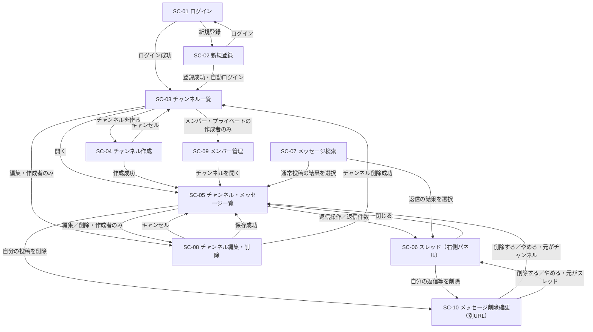

# 画面設計

[機能一覧](features.md)と[確認事項](questions.md)を先に確認し、[仕様書](../spec.md)、[画面カタログ](../../mockup/index.html)からたどれる9画面、[デザイン指定書](../../mockup/design-guide.md)を照合した。配置は[README](README.md)に従う。作成日：2026-10-26。

見た目・項目・既存の文言はモックアップ、文字数は仕様 §5-1、追加の振る舞いは確認事項のクライアント回答・ユーザーの決定を根拠にする。資料内の見本の人数・件数・本文は固定値にせず、実データを表示する。

## 画面一覧

| ID | 画面名 | 利用者・主な内容 | 関連機能 | 根拠 |
|:--|:--|:--|:--|:--|
| SC-01 | ログイン | 未ログインの社員。メールアドレス・パスワードでログイン、新規登録への移動 | F-02 | [login.html](../../mockup/login.html)、仕様 §3-1、Q-08 |
| SC-02 | 新規登録 | 未ログインの社員。表示名・メールアドレス・パスワード・確認用パスワードで登録 | F-01 | [register.html](../../mockup/register.html)、仕様 §3-1、Q-01・Q-02・Q-08 |
| SC-03 | チャンネル一覧 | ログインした社員。閲覧できるチャンネルの一覧、作成・編集・メンバー管理への移動 | F-04〜F-06 | [channels.html](../../mockup/channels.html)、仕様 §3-2、Q-03・Q-14 |
| SC-04 | チャンネル作成 | ログインした社員。名前・説明・公開範囲を指定して作成 | F-05 | [channel-new.html](../../mockup/channel-new.html)、仕様 §3-2、Q-04・Q-19 |
| SC-05 | チャンネル・メッセージ一覧 | 公開はログインした社員全員、プライベートはメンバー。通常投稿の閲覧・投稿・自分の投稿の編集、返信・削除確認への移動 | F-06・F-11〜F-15 | [channel-show.html](../../mockup/channel-show.html)、仕様 §3-4・§3-5、Q-15・Q-16・Q-18・Q-22 |
| SC-06 | スレッド | 対象チャンネルの閲覧・投稿権限がある社員。SC-05の右側パネルで親と返信を表示、返信の投稿・自分の返信の編集・削除確認 | F-13〜F-16 | [thread.html](../../mockup/thread.html)、仕様 §3-5、Q-05・Q-06・Q-15・Q-18 |
| SC-07 | メッセージ検索 | ログインした社員。閲覧できるチャンネルの通常投稿・返信を本文で検索、結果から会話へ移動 | F-17 | [search.html](../../mockup/search.html)、仕様 §3-6、Q-09〜Q-11・Q-14・Q-15 |
| SC-08 | チャンネル編集・削除 | 対象チャンネルの作成者。名前・説明の編集、画面内のチャンネル削除確認 | F-07・F-08 | [channel-edit.html](../../mockup/channel-edit.html)、仕様 §3-2、A-02、Q-04・Q-19・Q-21 |
| SC-09 | メンバー管理 | 対象プライベートチャンネルの作成者。メンバー一覧、追加対象の検索・選択、追加・解除 | F-09・F-10 | [members.html](../../mockup/members.html)、仕様 §3-3、A-04、Q-07・Q-18 |
| SC-10 | メッセージ削除確認 | 対象の通常投稿・返信を書いた本人。別URLの独立した画面で削除を確定・中止 | F-14 | ユーザー指定のQ-22・Q-23。対応するモック画面はない |

SC-06はモックと同じくチャンネルを残したパネル表示を1画面として数える。SC-08のチャンネル削除確認と本文の編集中は画面内の状態で、追加の画面番号は付けない。SC-10は個別メッセージの確認専用で、SC-08のチャンネル削除とは分ける。具体的なURLは `permissions-api.md` のルーティング設計で定義する。

カタログの `index.html` とデザイン指定書は資料であり、アプリの画面に含めない。公開APIにも画面番号を付けない。

## 画面遷移図

遷移はモックまたは確定した回答・決定に基づく。チャンネル操作成功後はQ-19、SC-10からはQ-23に従う。SC-10からは操作元に応じて片方へ戻る。削除済み返信も元の位置に削除表示を残し、返信件数に含める（Q-06）。

共通の移動と、画面番号を増やさない操作は次のとおり。

| 対象 | 操作と表示先 | 根拠 |
|:--|:--|:--|
| SC-03〜SC-09の上部・サイドバー | 検索→SC-07、チャンネル選択→SC-05、チャンネル一覧を見る→SC-03、ログアウト→SC-01 | 各ログイン後モック、F-03・F-04・F-17 |
| SC-05・SC-06 | 本文の編集／やめる／保存、以前の10件の表示は同じ画面の状態を再表示 | ガイド §4、Q-15・Q-18 |
| SC-07 | 検索・投稿日時の並べ替え・ページ移動は検索結果を再表示 | Q-10・Q-14・Q-15 |
| SC-08 | チャンネルの「削除する」→同じ画面内に確認欄。「やめる」→確認を中止 | channel-edit.html、ガイド §4、Q-21 |
| SC-09 | 検索→候補を1人選択→追加、メンバー解除は同じ画面で操作 | members.html、Q-07・Q-18 |

## 操作・表示の共通方針

- **JavaScriptは使用しない**（Q-18）。検索、スレッドの開閉、本文編集の開始・中止、過去分の表示、削除確認はリンクまたはフォーム送信による画面の再表示で行う。動的な文字数カウントや自動更新は設けない。
- 過去分の表示では、すでに表示していた範囲と古い10件をまとめて再表示する。ページ内リンクの位置指定により読んでいた箇所へ戻せる形にする（Q-15・Q-18）。検索結果からは対象の投稿・返信を含む範囲を表示し、該当箇所へ移動する（Q-11）。
- 入力欄には静的な上限目安を表示する。表示名は「30文字まで」、チャンネル名は「50文字まで」、説明は「200文字まで」、投稿・返信・本文編集は「1,000文字まで」。メールは「255文字まで」、登録パスワードは「8〜72文字で入力してください」とする。後二者は通しレビュー後のユーザー決定で、従来の上限未指定とモックの案内を更新する（Q-18・Q-37・Q-38）。
- ログイン後の共通表示はアプリ名「チームチャットアプリ」、上部検索、ログイン中の表示名、ログアウト、サイドバー。公開は `#`、プライベートは鍵の表示とし、未参加プライベートは名前・説明・存在を表示しない。チャンネルとサイドバーは作成順（F-04・F-21、Q-03・Q-14）。チャンネル削除時は、配下の全投稿・全返信を未編集・編集済み・個別削除済みの区別なく終了させる。データは保持するが、本文・削除表示・返信件数も画面・検索・公開APIから除外する（Q-26）。
- 作成者以外にチャンネル編集・削除・メンバー管理の操作を表示しない。他人のメッセージには編集・削除を表示しない。作成者のメンバー解除は無効な「外す」と「作成者は外せません」を表示する（仕様 §3-2〜§3-4、members.html）。
- PC・最小幅1,280px、上部52px・サイドバー260px・スレッド400pxを基準とし、配色・字体・余白・ホバー・フォーカス・無効状態はガイド §1〜§4に従う。日時は `YYYY/MM/DD HH:mm`、日付区切りとともに日本時間（JST／Asia/Tokyo）に統一する（F-21、Q-16）。
- モックの注記や「見本：結果が0件のとき」は製品に表示しない。エラー・0件・削除確認などは該当時だけ表示する（mockup/README.md、ガイド §5）。

## 画面項目定義

作成フォーム（SC-04）、会話と状態表示（SC-05）、検索とページ移動（SC-07）、権限と候補選択（SC-09）を代表として定義する。これらで、入力・会話・検索・メンバー操作の異なる構造を押さえられる。加えて、モックにない独立画面としてユーザーが指定したSC-10を定義する。他の5画面は後述の差分と共通定義を参照し、同じ項目を重ねて列挙しない。

### SC-04 チャンネル作成

根拠：[channel-new.html](../../mockup/channel-new.html)、仕様 §3-2・§5-1、F-05、Q-04・Q-18。

| 項目・操作 | 種別 | 必須・制約／表示・動作 |
|:--|:--|:--|
| チャンネル名 | テキスト入力 | 必須、50文字まで。公開・プライベートを通して未削除のチャンネルと同名不可。削除済みの名前は再利用可（Q-27） |
| 説明 | 複数行入力 | 任意、200文字まで |
| 公開範囲 | 単一選択 | 「公開」「プライベート」から1つ選択。各選択肢の説明はモックの表現を使う |
| キャンセル | リンク | SC-03へ戻る |
| 作成する | 送信ボタン | 入力を検証して作成し、作成者を自動でメンバーにする。成功後は対象のSC-05へ移動（Q-19） |

### SC-05 チャンネル・メッセージ一覧

根拠：[channel-show.html](../../mockup/channel-show.html)、ガイド §4、仕様 §3-4・§3-5・§5-1、A-05〜A-07、Q-15・Q-16・Q-18・Q-22。

| 項目・操作 | 種別 | 表示・動作 |
|:--|:--|:--|
| チャンネル見出し | 表示 | 名前、公開／プライベート、説明。作成者には「編集」「削除」を表示し、どちらもSC-08へ移動 |
| 通常投稿一覧 | 一覧 | 最初は最新10件を古い順に表示。返信はこの一覧に混ぜない。投稿者のアバター・表示名、投稿日時、本文、日付区切りを表示 |
| 以前のメッセージを表示 | 操作 | さらに過去がある場合に、古い10件を上に加えて再表示。表示済みの会話を残す |
| 返信操作・返信N件 | 操作／表示 | 対象の親を選んだSC-06を開く。件数は表示中の返信だけの数ではない |
| 編集 | 自分の投稿の操作 | 本文の位置を複数行入力にした状態を再表示し、周囲の会話を残す。「保存」「やめる」を表示。保存は必須・1,000文字まで、編集期限なし。編集中に別の編集が成功していた場合は、保存前に競合を案内する（Q-30） |
| 編集済み | 状態表示 | 編集後の本文末尾に「編集済み」を残す |
| 削除 | 自分の投稿の操作 | SC-10へ移動して確認。アイコンを押しただけでは削除しない |
| 削除済みの親 | 状態表示 | 元の本文を表示せず「このメッセージは削除されました」。投稿者・日時・返信とその件数を残し、スレッドを開ける |
| メッセージ本文 | 複数行入力 | 必須、1,000文字まで。案内は `#{チャンネル名} にメッセージを送る` に相当するモックの文言 |
| 送信 | 送信ボタン | 通常投稿を送信。返信用の入力欄と分ける |

編集競合では同じ画面・本文位置を使い、「別の画面で編集されています 内容を確認して保存してください」と案内する。「現在保存されている本文」と入力欄に残した「自分の入力」を確認し、「確認した内容で保存」または「やめる」を選べる。確認画面を表示しただけでは保存しない。SC-06の編集も同じ動作とする。版の照合と再競合の扱いは[behavior.md](behavior.md#本文編集の競合確認q-30)に従う（Q-30）。

通常投稿・返信の入力エラーは303で元の画面へ戻す。元がSC-06なら該当スレッドを開いたまま通常投稿・返信の表示範囲を維持し、本文のOld Inputとエラーは送信した欄にだけ表示する。左側の通常投稿と右側の返信、本文編集の欄で入力・エラーを混同しない。成功時は通常投稿ならSC-05の最新範囲、返信なら通常投稿の範囲を保ったSC-06の最新返信範囲へ戻る（Q-34、hidden項目はpermissions-api.md）。

### SC-07 メッセージ検索

根拠：[search.html](../../mockup/search.html)、仕様 §3-6、F-17、A-09・A-10、Q-09〜Q-11・Q-14・Q-15・Q-18。

| 項目・操作 | 種別 | 表示・動作 |
|:--|:--|:--|
| 検索キーワード・検索 | 入力／送信 | 検索語と本文の比較用の値をNFKC正規化・英字小文字化して部分一致で検索。正規化後に空白で区切った複数語は、すべて含むものを返す。保存済み本文は変えず、文字数上限の指定はない（Q-35） |
| 検索範囲 | 条件 | 通常投稿と返信。削除済みの本文は除外し、本人が閲覧できるチャンネルだけを対象とする。チャンネル名・人名の検索は設けない |
| 検索語・結果件数 | 表示 | 入力した検索語と実際の一致件数を表示。現在のページの10件を全件数として扱わない |
| 投稿日時の並べ替え | 選択／送信 | 初期は新しい順。古い順にも変更できる。検索語を維持し、順序の変更時は1ページ目へ戻る |
| 検索結果行 | 一覧／リンク | チャンネル名・投稿者・投稿日時・本文、一致語に対応する元本文の範囲の強調。通常投稿はSC-05の対象箇所、返信はSC-06の対象箇所へ移動。正規化で文字数が変わっても強調位置を揃える（Q-35） |
| 前へ・ページ番号・次へ | ページ移動 | 1ページ10件。検索語・並び順・初回のID上限を維持する。検索語・並び順を変えるか先頭から検索し直すときは1ページ目へ戻して上限を取り直す。新規IDの混入を抑えるが、削除・本文編集・所属変更によるずれは残る（Q-31） |
| 0件の案内 | 状態表示 | `「{検索語}」に一致するメッセージはありません` と `別のキーワードで試すか、キーワードを短くしてください。`。入力エラーと区別する |

有効な要求ページが現在の最終ページを超えた場合は、検索語・並び順・初回ID上限を保って最後のページへ302リダイレクトする。全体0件では1ページ目で0件案内を表示する。公開APIの範囲外ページ200・空配列とは分ける（Q-36）。検索の正規化・`%`と`_`の文字扱いはpermissions-api.mdに従う。

### SC-09 メンバー管理

根拠：[members.html](../../mockup/members.html)、仕様 §3-3、F-09・F-10、A-04、Q-07・Q-18・Q-29。

| 項目・操作 | 種別 | 表示・動作 |
|:--|:--|:--|
| 対象チャンネル | 表示 | 名前・プライベートの表示・説明。「チャンネルを開く」でSC-05へ移動 |
| 表示名またはメールアドレスで探す | 入力 | 入力語全体と表示名・メールの比較用の値をNFKC正規化・英字小文字化し、部分一致する登録済み社員を探す。保存値は変えず、文字数上限の指定はない。本文検索の複数語ANDは流用しない（Q-29・Q-35） |
| 検索 | 送信ボタン | JavaScriptなしで候補を再表示する。空・空白だけの場合は検索を実行せず候補を出さない（Q-18・Q-29） |
| 追加候補 | 一覧／1人選択 | 既存メンバーを除外し、表示名昇順・同名ならID昇順。表示名とメールを併記し、1人を選ぶ。同姓同名でもメールで識別できるようにする（Q-29） |
| 追加 | 送信ボタン | 選択した1人をチャンネルのメンバーにする |
| メンバー一覧・人数 | 表示 | アバター、表示名、メールアドレス、作成者の印と実際の人数 |
| 外す | 送信ボタン | 作成者以外のメンバーを解除。作成者の行は無効とし「作成者は外せません」を添える |

検索0件は入力エラーにせず「追加できるメンバーが見つかりません」と、検索語を変える案内を表示する（Q-29。文言はQ-20の方針で作成）。未検索の空欄とは区別する。

### SC-10 メッセージ削除確認

根拠：Q-22・Q-23。対象内容の表示はSC-05・SC-06、危険操作のボタン表現はガイド §4を参照する。

| 項目・操作 | 種別 | 表示・動作 |
|:--|:--|:--|
| 削除対象 | 表示 | 対象の通常投稿または返信の投稿者・日時・本文を示し、何を削除するか確認できるようにする |
| 削除する | 確定ボタン | 自分の対象メッセージを削除し、元のSC-05またはSC-06へ戻る。危険操作の赤い塗りボタンを使う |
| やめる | 中止リンク | 削除せず、元のSC-05またはSC-06へ戻る |

確認専用の別URLとする。チャンネル名の確認入力やチャンネル全体の削除を、この画面には持ち込まない。削除済み返信も位置と件数を残し（Q-06）、元本文は保持するが画面には出さない（Q-17）。

### その他の画面は差分だけ定義する

| 画面 | 共通定義・代表画面との差分 | 根拠 |
|:--|:--|:--|
| SC-01 | 認証用カード。メールアドレス・伏せ字のパスワード、「ログイン」、新規登録へのリンク。成功時はSC-03、認証失敗時の文言は下表を使用 | login.html、Q-08 |
| SC-02 | SC-01と同じ認証用カード。表示名と確認用パスワードを加え、「登録する」、ログインへのリンク。全4項目必須。成功時は自動ログインしてSC-03 | register.html、Q-08 |
| SC-03 | 共通上部・サイドバーと、チャンネル名・種別・説明・作成者の一覧。「開く」「チャンネルを作る」、本人が作成した行の「編集」、プライベートの作成者に「メンバー」。並びと非表示は共通方針に従う | channels.html、Q-03・Q-14 |
| SC-06 | 返信の表示件数・並び・過去分表示、本文入力・送信、本人の編集・削除はSC-05と同じ。差分：SC-05を残した右側の「スレッド」パネルにチャンネル名・親・全返信件数・返信一覧・「閉じる」を表示。過去分の操作名は「以前の返信を表示」、入力欄は「返信を送る」。過去分を表示しても親と全返信件数を残す。チャンネルが存続する間は個別削除済みの親にも返信可能で、返信は1段まで | thread.html、A-06、Q-05・Q-06・Q-15 |
| SC-08 | 名前・説明はSC-04と同じ制約で既存値を表示。「保存する」「キャンセル」。公開範囲は変更不可として現在の種別を案内する。下の削除欄は「削除する」で画面内確認を表示し、対象名・通常投稿と返信の実件数・取り消せない旨・確認用チャンネル名入力・「やめる」「削除する」を置く。入力名が一致した場合だけチャンネルを削除状態にし、個別の編集・削除状態を問わず配下の全投稿・全返信を終了させる。本文・削除表示・返信も取得対象から外す。データは保持する | channel-edit.html、A-02、Q-21・Q-26 |

## 入力チェックとエラーメッセージ

エラー文は、モックまたは既存決定の文言をそのまま使うものと、Q-20で承認された方針に従い同じ言い回しで作成したものを区別する。必須・長さ違反は仕様 §5-1を根拠とし、通しレビュー後にユーザーが採用したメール255文字・登録パスワード72文字の上限を追加する（Q-37・Q-38）。

| 対象画面・入力 | チェック | 表示するエラーメッセージ | 文言・条件の根拠 |
|:--|:--|:--|:--|
| 全画面の文字入力（空判定共通） | 前後の空白・改行を取り除いた判定用の値で空かどうかを確認する。空白・改行だけの入力は空として扱う | 必須項目・SC-07の検索キーワードは各項目の空入力エラーを表示。任意の説明は空を許可。SC-09の空検索は候補を出さない | ユーザー指定（2026-10-26）、Q-29 |
| SC-02 表示名 | 必須／30文字以内 | `表示名を入力してください`／`表示名は30文字以内で入力してください` | register.html、仕様 §5-1。文言作成：Q-20 |
| SC-01・SC-02 メールアドレス | 前後空白・改行を除去し、ドメインの英字を小文字に揃えた値で必須・形式・照合を確認する | `メールアドレスを入力してください`／`メールアドレスを正しい形式で入力してください` | 各モックのメール入力、Q-32。文言作成：Q-20 |
| SC-01・SC-02 メールアドレス | 上記の正規化後に255文字以内。切り捨てない | `メールアドレスは255文字以内で入力してください` | Q-37のユーザー決定。文言作成：Q-20 |
| SC-02 メールアドレス | 同じ正規化をした登録済みの値と重複不可。`@`前の大小・全角半角・Unicodeの表記差は変換しない | `このメールアドレスは登録されています` | Q-02の決定済み文言、Q-32 |
| SC-01・SC-02 パスワード | 必須 | `パスワードを入力してください` | 各モック。文言作成：Q-20 |
| SC-02 パスワード | 8文字以上、72文字以内。空白除去・大小変換・Unicode正規化・切り捨てなし | `パスワードは8文字以上で入力してください`／`パスワードは72文字以内で入力してください` | 最小値は仕様 §5-1・register.html、上限はQ-38のユーザー決定。文言作成：Q-20 |
| SC-02 パスワード（確認用） | 必須／パスワードと一致 | `パスワード（確認用）を入力してください`／`パスワード（確認用）が一致しません` | register.html、Q-20 |
| SC-01 認証 | メールアドレスとパスワードの組み合わせが正しいこと | `メールアドレスまたはパスワードが正しくありません` | login.htmlの原文、F-02 |
| SC-04・SC-08 チャンネル名 | 必須／50文字以内 | `チャンネル名を入力してください`／`チャンネル名は50文字以内で入力してください` | 必須の文言はchannel-new.htmlの原文。上限は仕様 §5-1、上限文言作成：Q-20 |
| SC-04・SC-08 チャンネル名 | 未削除の他チャンネルと完全一致で同名不可。前後空白・英字大小・全角半角・Unicodeの表記差は別名。編集時は自チャンネルを除き、削除済みの名前は再利用可 | `使用できない名前です` | Q-04・Q-27・Q-32。文言はQ-28のユーザー指定。公開／プライベートで同じ文言とし、重複が理由であることや既存チャンネルの情報・種別は説明しない（Q-03・Q-28） |
| SC-04・SC-08 説明 | 任意／200文字以内 | `説明は200文字以内で入力してください` | channel-new.html、仕様 §5-1。文言作成：Q-20 |
| SC-04 公開範囲 | 公開・プライベートのいずれか1つ | `公開範囲を選択してください` | channel-new.html、仕様 §3-2。文言作成：Q-20 |
| SC-05・SC-06 本文（新規・返信・編集） | 必須／1,000文字以内 | `メッセージを入力してください`／`メッセージは1,000文字以内で入力してください` | 仕様 §5-1、ガイド §4。文言作成：Q-20 |
| SC-07 検索キーワード | 空のまま検索しない | `検索キーワードを入力してください` | 仕様 §5-1の空入力への対応、Q-20による文言作成 |
| SC-09 追加対象 | 1人選択してから追加 | `追加するメンバーを選択してください` | Q-07・Q-18。文言作成：Q-20 |
| SC-08 削除確認のチャンネル名 | 必須／対象名と完全一致。前後空白・英字大小・全角半角・Unicodeの表記差を区別し、確認値を自動でtrim・正規化しない | `確認のためチャンネル名を入力してください`／`チャンネル名が一致しません` | channel-edit.html、Q-21・Q-32。文言作成：Q-20 |

ログイン時のパスワードには登録用の8文字以上のチェックを適用せず、変換・切り捨てをせずに認証結果で判断する。パスワードの必須判定は空白だけの入力を拒否するが、それ以外の値の前後空白は保持する。メールはQ-37の255文字以内を適用し、検索語・メンバー検索語には上限を追加しない。確認用チャンネル名はQ-21の一致判定とし、別の長さ上限は追加しない。

入力エラーでは登録・変更・削除を実行せず、同じ画面に表示する。該当入力欄の赤い枠・薄赤の背景・丸い `!` と、欄の下の12pxの赤い文言を用い、エラー文は句点なしの1文とする（ガイド §4）。認証失敗の配置はlogin.htmlに合わせる。

検索結果0件と削除済み表示は入力エラーではない。0件はSC-07の案内、削除済みの親はSC-05の状態表示を使う。空状態の枠や案内の表現はガイド §4「空・0件」に従う。

## データ設計時の決定と根拠の扱い

- **Q-06**：削除済み返信も元の位置に削除表示を残し、返信件数に含める。
- **Q-17・Q-24・Q-25**：メッセージの行・元本文・削除日時を保持し、削除表示は画面側で出す。取得を論理削除の既定除外に任せず、画面では行を残し、検索・公開APIでは削除済みを除外する。
- **Q-26・Q-27**：チャンネル削除時は配下の全投稿・全返信を個別状態にかかわらず終了させる。所属・会話を含む保存データは保持するが、削除表示も含め画面・検索・公開APIから除外する。削除済みのチャンネル名は再利用できる。

各画面の根拠は一覧・項目定義に、各入力の根拠はチェック表に記載した。原資料の9画面はすべて画面一覧と差分まで照合し、モックにないSC-10、JavaScriptを使わない操作、検索・過去分の表示は、確認事項に記録したユーザーの決定を根拠にしている。

## Issue #1の実装範囲

認証画面はFortifyと自前のBladeで実装する。SC-01・SC-02は[画面一覧](#画面一覧)と[入力チェック](#入力チェックとエラーメッセージ)を参照する。

2026-10-30のユーザー決定により、共通レイアウトの上部バーはアプリ名・ログイン中の表示名・ログアウトだけを作る。認証が必要なGET `/channels`は見出しだけを表示する。上部バーの検索入力欄は検索のIssue、左サイドバーとチャンネルの行はチャンネルのIssueで実装する。

## Issue #2の実装範囲

- SC-03・SC-04・SC-08とサイドバーを実装する。プライベートの作成者に表示する「メンバー」は、管理画面の実装まで無効表示とする（ユーザー決定）。他の社員や公開チャンネルには表示しない。
- SC-05はチャンネル名・公開種別・説明・作成者用の編集／削除導線までを実装する。会話一覧・投稿欄・返信は後続Issueで作る。未実装の会話を「0件」と判定・表示せず、本文領域は空けておく。
- 検索欄は検索Issueで実装する。これらは段階実装の範囲であり、完成時の画面・機能要件は変更しない。AC-2-1の実投稿、TP-2-9の会話表示・検索・公開APIとの結合確認は後続機能が揃ってから行う。
